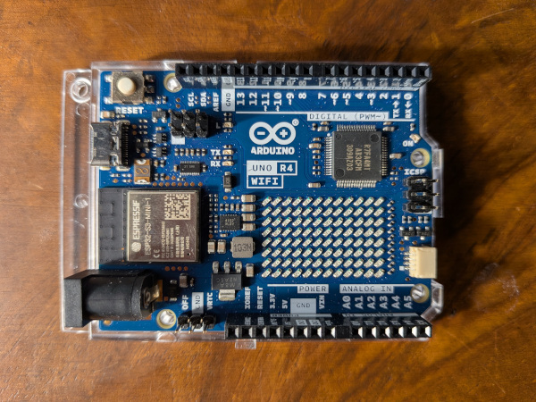

Yes, there is another TinyGo already. The [TinyGo 0.44 release](https://github.com/tinygo-org/tinygo/releases/tag/v0.44.0) arrives only a few weeks after 0.43, because the team is moving fast right now and we did not want to sit on all this good stuff. This time the theme is simple. Your programs get smaller, they run faster, and pretty much everything works better than it did before.

## Less Memory, More Room

Every byte counts, especially on a microcontroller, so we went on the hunt for more of them to give back to you.

The `interp` package now runs a lot more of your program's initialization while compiling. Map lookups, `memset`, interface hashing, private atomic operations, and deferred initialization can all be worked out ahead of time, so that work never has to happen on the device. Running your TinyGo on an actual operating system? The `os` package no longer does startup work for temporary files that your program never uses.

The result is smaller binaries that use less RAM and start up more quickly than ever.

## Gotta Go Faster

Speed got some attention as well. The compiler now skips slice bounds checks that can never fail, and it avoids copying byte slices in more kinds of string comparisons. On the RP2040 and RP2350 the PLL calculations have moved out of startup entirely.

None of these require that you change a single line of your code. Just rebuild with 0.44, and enjoy your new performance boost.

## All Cores On Deck

Multicore support with the `cores` scheduler has been getting a real workout on the RP2040 and RP2350, and it is in great shape. This release adds core affinity, so you can choose which core a goroutine runs on. We also fixed a scheduler lock starvation issue and made random number reads safe across cores.

And now the ESP32-S3 joins the multicore party! Both of its Xtensa LX7 cores can run your goroutines with the `cores` scheduler, with core affinity included. The ESP32-S3 also picked up USB-OTG device support and flash `BlockDevice` support in this release.

## New Boards

We have several new boards in this release, including the Arduino Uno R4, which adds our first support for [Renesas](https://www.renesas.com/en) processors.

* [Arduino Uno R4 Minima](https://store.arduino.cc/products/uno-r4-minima)
* [Arduino Uno R4 WiFi](https://store.arduino.cc/products/uno-r4-wifi)
* [NUCLEO-F401RE](https://www.st.com/en/evaluation-tools/nucleo-f401re.html)
* [M5Stack StampFly](https://docs.m5stack.com/en/app/Stamp%20Fly)

We have also extended the functionality and fixed issues on many other boards, especially the ESP32xx-family.

## WebAssembly Keeps Getting Better

WebAssembly has been one of our real strengths, and WASM programs built with TinyGo are faster and more reliable than ever. The garbage collector now scans only the live part of Asyncify stacks, which saves real time in programs that use lots of goroutines. Sleep times are rounded correctly, file reads and writes on WASI never report a negative count, and environment variables are parsed properly when running under JavaScript. Builds are way quicker too, now that `wasm-opt` is linked with `mimalloc` on Linux.

See the [CHANGELOG](https://github.com/tinygo-org/tinygo/releases/tag/v0.44.0) for everything else that went into this release.

## TinyGo Drivers 0.37

The [TinyGo drivers](https://github.com/tinygo-org/drivers) repo is where we keep our collection of sensors, actuators, displays, and other hardware peripherals that you can use with TinyGo. This also has a [new release](https://github.com/tinygo-org/drivers/releases/tag/v0.37.0), with ten new devices:

* Bosch BMI270 IMU
* Bosch BMM150 magnetometer
* CAP1166 touch and LED controller
* ILI9325 8-bit parallel display
* TI INA3221 three channel power monitor
* PixArt PMW3901 optical flow sensor
* SN3218 LED driver
* ST7036 character LCD
* VL53L3CX time-of-flight sensor
* Waveshare 2.7 inch e-Paper display (epd2in7)

The new drivers are written to avoid heap allocations, which keeps them fast and predictable even when your device is short on memory. We also went back and removed allocations from some of the older ones.

There are plenty of other improvements to existing drivers too, such as encoder support for the ESP32, ESP32-S3, and ESP32-C6.

## espradio Update

The [espradio](https://github.com/tinygo-org/espradio) package that powers wireless on the Espressif chips has seen two releases since our last post.

Bluetooth now works on the classic ESP32, so that drawer full of older boards just got even more useful. On the ESP32-S3, espradio can run the radio on core 0 while the `cores` scheduler handles your code, which means that your code is not waiting on the radio.

We also moved to the latest version of [lneto](https://github.com/soypat/lneto), our high-performance networking stack designed for tiny devices. espradio now uses the lneto netstack directly, and adds NTP, RSSI for the connected access point, transmit power control, a configurable receive ring, and ESP-NOW send and receive without allocating.

## Bluetooth Update

The [TinyGo Bluetooth](https://github.com/tinygo-org/bluetooth) package has a [new release](https://github.com/tinygo-org/bluetooth/releases/tag/v0.17.0) too, and it is a big one.

You can now use Bluetooth from WebAssembly in the browser! The new backend uses the [Web Bluetooth API](https://developer.mozilla.org/en-US/docs/Web/API/Web_Bluetooth_API) for the central role, so the same Go code can talk to your devices from a web page.

Under the hood there has been a major refactoring. The HCI, L2CAP, and ATT protocol code moved into its own `hci` package with no build tags, so it can be tested right on your computer. Test coverage for it is now at 87 percent, and that testing uncovered a number of bugs which are now fixed. The common types like `UUID` and `MAC` moved into a new `ble` package, with aliases so that your existing code keeps working.

For the nRF52840 there are new low power features, such as setting the transmit power, controlling the DC/DC converters, and detecting when the USB cable is removed. There is a new low power beacon example to show how it all fits together.

The ESP32 family got many improvements thanks to the espradio updates, including support for the classic ESP32. On desktop operating systems, macOS and Windows each received fixes, with Windows in particular getting much more reliable connections, scanning, and error reporting.

## Thanks, Team TinyGo and friends!

A release like this, so soon after the last one, only happens because of the people who show up and do the work. To everyone who wrote code, reviewed pull requests, tested on real hardware, filed issues, and improved the docs, thank you!
